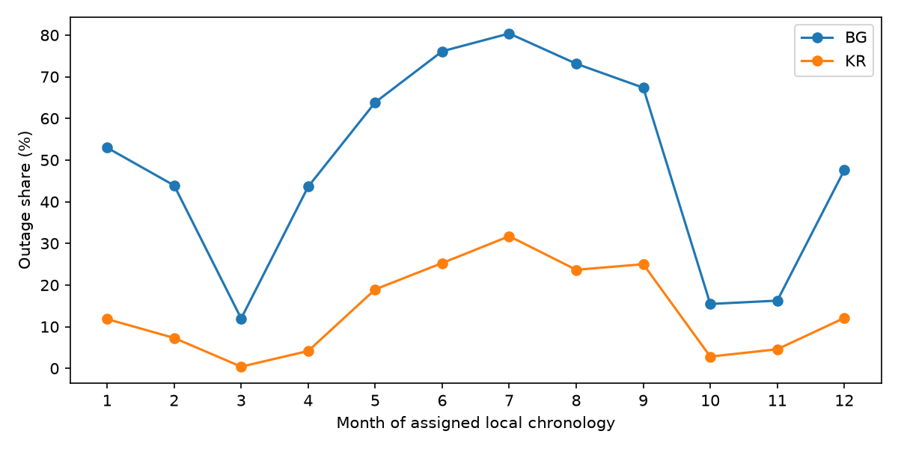

# Independent benchmark verification

Verdict: **REPRODUCED**. All 80 of 80 metric comparisons pass the predeclared tolerances; 0 fail. This is numerical reproduction within tolerance, not exact reproduction of the forest outputs.

No future-observation feature or test-month training target was found in the time-ordered evaluation. The random holdout is consistent with the README's random comparison, but it is not prospective forecasting evidence.

## Independence and reproducibility

The loader, features, estimators, splits and metrics were implemented and executed before reading the benchmark result CSV or source. The required README summaries were visible beforehand. The original verifier source is preserved at `agent_notes/S1_bench_verify/independent_frozen.py`; its SHA256 is `9d7fd00289d7b6f94b2f92acbb9eb83b86aaf2754eabe77c0695e236b32a21eb`. Comparison and report code were appended after freezing the independent output files. The original computation was not tuned or rerun to improve agreement.

`results/freeze.json` stores input/output hashes, configuration, software versions and timing. This run used Python 3.12.15, scikit-learn 1.7.2, NumPy 2.5.4, pandas 2.3.3 and openpyxl 3.1.5. The independent experiment took 230.54 seconds. RF seed: 42; forest trees: 300; minimum leaf size: 5; execution threads: 1. LR uses StandardScaler fitted inside each training fold and max_iter=3000, otherwise installed defaults. There is 1 fixed-seed run, not a multiple-seed uncertainty study. Statistical test: none; these are numerical tolerance checks, not significance tests.

Reproduce from the repository root (PowerShell):

```powershell
$env:PYTHONDONTWRITEBYTECODE='1'
python studies/S1_outage_forecasting/benchmark/verify/verify_benchmark.py independent --run-name replication
python studies/S1_outage_forecasting/benchmark/verify/verify_benchmark.py compare --run-name replication
python studies/S1_outage_forecasting/benchmark/verify/verify_benchmark.py compare
python studies/S1_outage_forecasting/benchmark/verify/verify_benchmark.py report
python -m pytest -q -o cache_dir=agent_notes/S1_bench_verify/pytest_cache tests studies/S1_outage_forecasting/benchmark/verify/tests
```

All generated artifacts stay under `verify/results/`. Tests live under `verify/tests/` because the task restricts writes outside the verifier and its notes directory. Independent computation never imports the benchmark. Each rerun requires a new run name and writes under `results/runs/`; nonempty run directories are rejected. Comparison validates the saved source snapshot, configuration, inputs and output hashes. The default comparison and report commands use the original frozen run.

## Data and availability convention

The specified workbook columns are loaded without rounding, sorting, imputation, clipping, or timezone conversion. The selected hourly rows receive the specified local chronology. Outage is exactly grid energy equal to zero; missing grid would remain missing. Load is grid plus generator energy, in kWh. Negative and non-numeric counts are audited separately.

| site | rows | non_numeric | grid_kwh_nan | grid_kwh_negative | generator_kwh_nan | generator_kwh_negative |
| --- | --- | --- | --- | --- | --- | --- |
| BG | 8760 | 0 | 0 | 0 | 0 | 0 |
| KR | 8760 | 0 | 0 | 0 | 0 | 0 |

Annual and monthly outage shares use observed grid rows as denominators; counts and missing counts are retained below and in `outage_shares.csv`.

| site | period | rows | observed | missing | outage_hours | outage_share |
| --- | --- | --- | --- | --- | --- | --- |
| BG | annual | 8760 | 8760 | 0 | 4328.000000 | 0.494064 |
| BG | 2018-01 | 744 | 744 | 0 | 394.000000 | 0.529570 |
| BG | 2018-02 | 672 | 672 | 0 | 295.000000 | 0.438988 |
| BG | 2018-03 | 744 | 744 | 0 | 89.000000 | 0.119624 |
| BG | 2018-04 | 720 | 720 | 0 | 314.000000 | 0.436111 |
| BG | 2018-05 | 744 | 744 | 0 | 475.000000 | 0.638441 |
| BG | 2018-06 | 720 | 720 | 0 | 548.000000 | 0.761111 |
| BG | 2018-07 | 744 | 744 | 0 | 598.000000 | 0.803763 |
| BG | 2018-08 | 744 | 744 | 0 | 544.000000 | 0.731183 |
| BG | 2018-09 | 720 | 720 | 0 | 485.000000 | 0.673611 |
| BG | 2018-10 | 744 | 744 | 0 | 115.000000 | 0.154570 |
| BG | 2018-11 | 720 | 720 | 0 | 117.000000 | 0.162500 |
| BG | 2018-12 | 744 | 744 | 0 | 354.000000 | 0.475806 |
| KR | annual | 8760 | 8760 | 0 | 1229.000000 | 0.140297 |
| KR | 2018-01 | 744 | 744 | 0 | 88.000000 | 0.118280 |
| KR | 2018-02 | 672 | 672 | 0 | 49.000000 | 0.072917 |
| KR | 2018-03 | 744 | 744 | 0 | 3.000000 | 0.004032 |
| KR | 2018-04 | 720 | 720 | 0 | 30.000000 | 0.041667 |
| KR | 2018-05 | 744 | 744 | 0 | 141.000000 | 0.189516 |
| KR | 2018-06 | 720 | 720 | 0 | 182.000000 | 0.252778 |
| KR | 2018-07 | 744 | 744 | 0 | 236.000000 | 0.317204 |
| KR | 2018-08 | 744 | 744 | 0 | 176.000000 | 0.236559 |
| KR | 2018-09 | 720 | 720 | 0 | 180.000000 | 0.250000 |
| KR | 2018-10 | 744 | 744 | 0 | 21.000000 | 0.028226 |
| KR | 2018-11 | 720 | 720 | 0 | 33.000000 | 0.045833 |
| KR | 2018-12 | 744 | 744 | 0 | 90.000000 | 0.120968 |



Forecasts assume completed metering observations through origin t are available. If timestamps denote interval starts, issue time must be after that interval completes. The raw workbook selection alone does not establish metering latency or timestamp semantics. Target clock values are known calendar information, not future measurements.

## Features and time-ordered evaluation

The enumerated feature list actually produces **19** columns, despite the task and README calling it eighteen. Every enumerated feature was included, in the listed order. The benchmark source has the same feature count. Current-state duration includes the origin. All rolling windows are complete, and same-hour history requires all 7 preceding daily values. No future observation enters a predictor.

| site | horizon_h | features | raw_rows | feature_missing | target_missing | excluded | retained |
| --- | --- | --- | --- | --- | --- | --- | --- |
| BG | 1 | 19 | 8760 | 168 | 1 | 169 | 8591 |
| BG | 6 | 19 | 8760 | 168 | 6 | 174 | 8586 |
| KR | 1 | 19 | 8760 | 168 | 1 | 169 | 8591 |
| KR | 6 | 19 | 8760 | 168 | 6 | 174 | 8586 |

Test origins cover months 4 through 12; models are refitted for each month using only origins and targets strictly before its boundary. Test-month observations up to the current origin update features, never fitted parameters. Test targets may cross into the next month; end-of-year unavailable targets are excluded. `folds.csv` records train/test counts and boundary timestamps, and `predictions.csv` records every pooled origin, target, truth and probability.

Accuracy and F1 use probability >= 0.5; F1 with zero denominator is zero. AUC uses continuous probabilities; a single-class sample would produce missing AUC. Brier is mean squared probability error. Metrics are computed on pooled test predictions, not averaged fold scores.

| site | horizon_h | method | n | accuracy | f1 | auc | brier |
| --- | --- | --- | --- | --- | --- | --- | --- |
| BG | 1 | always_0 | 6599 | 0.462040 | 0.000000 | 0.500000 | 0.537960 |
| BG | 1 | persistence | 6599 | 0.741779 | 0.760000 | 0.740282 | 0.258221 |
| BG | 1 | same_hour | 6599 | 0.753296 | 0.777535 | 0.822896 | 0.173752 |
| BG | 1 | LR | 6599 | 0.811032 | 0.832864 | 0.886527 | 0.134136 |
| BG | 1 | RF | 6599 | 0.825428 | 0.844576 | 0.910910 | 0.120814 |
| BG | 6 | always_0 | 6594 | 0.461632 | 0.000000 | 0.500000 | 0.538368 |
| BG | 6 | persistence | 6594 | 0.667728 | 0.691365 | 0.665772 | 0.332272 |
| BG | 6 | same_hour | 6594 | 0.753109 | 0.777535 | 0.822626 | 0.173884 |
| BG | 6 | LR | 6594 | 0.776615 | 0.803888 | 0.847686 | 0.156671 |
| BG | 6 | RF | 6594 | 0.777828 | 0.807919 | 0.848734 | 0.154636 |
| KR | 1 | always_0 | 6599 | 0.834975 | 0.000000 | 0.500000 | 0.165025 |
| KR | 1 | persistence | 6599 | 0.720261 | 0.152433 | 0.492460 | 0.279739 |
| KR | 1 | same_hour | 6599 | 0.811184 | 0.344900 | 0.748220 | 0.135435 |
| KR | 1 | LR | 6599 | 0.912563 | 0.701191 | 0.887179 | 0.071373 |
| KR | 1 | RF | 6599 | 0.915745 | 0.699134 | 0.917079 | 0.067614 |
| KR | 6 | always_0 | 6594 | 0.834850 | 0.000000 | 0.500000 | 0.165150 |
| KR | 6 | persistence | 6594 | 0.700334 | 0.092746 | 0.456636 | 0.299666 |
| KR | 6 | same_hour | 6594 | 0.811040 | 0.344900 | 0.748082 | 0.135538 |
| KR | 6 | LR | 6594 | 0.896118 | 0.629930 | 0.855575 | 0.085188 |
| KR | 6 | RF | 6594 | 0.901880 | 0.630497 | 0.876247 | 0.081407 |

## Comparison and discrepancies

References must match after rounding to 4 decimals. LR absolute tolerance is 0.002; RF absolute tolerance is 0.005. Published values have 4 decimal places. `comparison.csv` contains ours, theirs, absolute differences, rules and pass/fail for every requested metric.

| method | comparisons | passed | max_abs_diff |
| --- | --- | --- | --- |
| always_0 | 16 | 16 | 0.000050 |
| persistence | 16 | 16 | 0.000046 |
| same_hour | 16 | 16 | 0.000048 |
| LR | 16 | 16 | 0.000037 |
| RF | 16 | 16 | 0.003366 |

The largest forest difference occurs here:

| site | horizon_h | metric | ours | theirs | abs_diff |
| --- | --- | --- | --- | --- | --- |
| KR | 1 | f1 | 0.699134 | 0.702500 | 0.003366 |

References and LR agree at published precision. RF differs beyond publication rounding but stays within the predeclared tolerance. The benchmark requests all available threads and the verifier fixes a single thread; the original run's package/build environment is not recorded in the published CSV. The exact cause of the forest differences is therefore **unresolved**, and cannot be attributed to threading alone. No settings or output values were changed to obtain agreement.

The benchmark's same-hour mean skips missing values, whereas the verifier requires a complete history. For these observed files, the longest required lag excludes initial incomplete histories and the data audit finds no missing energy, so this semantic difference has no retained-row effect. The benchmark also turns missing grid into non-outage; this is a robustness caveat, not an observed defect in these clean inputs.

## Source-line leakage audit

The following review was performed only after numerical comparison. Line numbers refer to `benchmark.py`, SHA256 `ff828b4ad30521f17b88c045b7857c9f618651ad2e36496f091176974d056e41`. `leakage_audit.csv` expands this table to individual source lines, including their exact text.

| lines | area | latest_information | verdict | reason |
| --- | --- | --- | --- | --- |
| 47 | Assigned hourly chronology | row t | CAUSAL / ASSUMPTION | Assigns the specified local chronology; raw interval-start/end semantics are not established by this code. |
| 53, 54, 56, 57, 58, 59, 60 | Loading, energy sum, outage label | t | CAUSAL / DATA CAVEAT | Same-row energy and grid-equals-zero label. Missing grid would become a non-outage in benchmark; independent data audit must establish this is absent in these files. |
| 66, 67, 68 | Current outage | t | CAUSAL | Requires origin-hour metering to have completed. |
| 69, 70 | Outage lags | t minus lag | CAUSAL | All shifts are positive and use past rows. |
| 71, 72 | Rolling outage means | t | CAUSAL | Trailing windows include the origin; no centered window or backward fill. |
| 73 | Current-state duration | t | CAUSAL | Cumulative count since the most recent change depends only on the prefix, despite grouping over the full frame. |
| 74, 75, 76, 77 | Target calendar and origin weekday | known calendar at t+h | CAUSAL | Future calendar information is known at issue time; no future observed outage or load is used. |
| 78, 79 | Same target-clock-hour history | t+h minus one day | CAUSAL / COMPLETENESS CAVEAT | Offsets are past-only for the requested horizons. Benchmark mean skips NaNs; verifier requires all days. The longest outage lag excludes the initial incomplete history, and raw audit finds no missing energy, so retained rows agree. |
| 80 | Lagged load | t minus one hour | CAUSAL | Positive shift of grid plus generator energy. |
| 81 | Rolling load | t | CAUSAL | Trailing full window; assumes completed origin-hour energy is observable. |
| 86, 88, 89, 90, 100, 101, 102 | Scaling and pipeline construction | training subset | CAUSAL FOR MONTHLY TEST | Scalers are inside pipelines and fitted with the training subset. MLP internal early stopping and SVC probability calibration remain within outer training; they are not separately verified here. |
| 45, 92 | RF configuration | training subset | CAUSAL | Specified fixed seed and forest settings; benchmark uses all threads, verifier fixes one thread. The original execution environment is not recorded here. |
| 118, 119, 120, 121 | Target shift and eligibility | target t+h for labels only | CAUSAL / LABEL ONLY | Negative shift creates future truth, not a predictor. Filtering removes unavailable features and targets. Feature computation over the full chronology remains causal. |
| 124, 125, 126, 127, 128 | Monthly train/test masks | training targets strictly before test month | CAUSAL | Both origin and target must precede the test boundary. Test selection is by origin month; last origins may have targets in the next month as specified. |
| 129, 130, 131 | Reference probabilities | t | CAUSAL | Constant zero, current outage, and historical same-hour probability; no fitting on test outcomes. |
| 132, 134, 135, 137, 138, 139 | Monthly model fit and prediction | training subset / current test origin | CAUSAL | Fresh models per month; training-only fit and held-out prediction. Fold outcomes are scored without model updates. |
| 107, 108, 109, 110, 140, 141, 142, 143, 144, 145, 146, 161 | Threshold, pooling and publication precision | held-out truth for scoring only | CAUSAL / EVALUATION | Fixed threshold, concatenated predictions across folds, and rounding at export. No monthly-score averaging or test-driven threshold selection. |
| 147, 148, 149, 150, 151, 152 | Random comparison | arbitrary earlier and later eligible origins | NON-PROSPECTIVE / README-CONSISTENT | Random row holdout over the full eligible year, default shuffle, month stratification and fixed seed. Pipelines fit on random training only. Later observations can train models used on earlier held-out origins and lag histories overlap held-out labels; this is not a causal forecasting evaluation. Accuracy uses model.predict, not the probability threshold scoring helper. |

## Random holdout audit

The population is the full eligible year, including the months before the chronological evaluation begins. The split unit is an hourly origin row; sklearn's shuffled train_test_split uses a test fraction of 0.2, seed 42, and stratification by origin month, not target class. The source's fresh algorithm instances use the same settings as its monthly evaluation. Scalers are fitted only on random training rows. Accuracy is calculated with estimator.predict; random reference scores are not reported. The random split was reconstructed to inspect membership/counts; models were not refitted for random accuracy reproduction, which is outside the requested metric comparison.

| site | horizon_h | eligible | training | test | test_fraction_requested | seed | shuffle | stratification | unit | first_origin | last_origin | test_origins_before_last_training_origin |
| --- | --- | --- | --- | --- | --- | --- | --- | --- | --- | --- | --- | --- |
| BG | 1 | 8591 | 6872 | 1719 | 0.200000 | 42 | True | origin month | hourly origin row | 2018-01-08 00:00:00 | 2018-12-31 22:00:00 | 1719 |
| BG | 6 | 8586 | 6868 | 1718 | 0.200000 | 42 | True | origin month | hourly origin row | 2018-01-08 00:00:00 | 2018-12-31 17:00:00 | 1718 |
| KR | 1 | 8591 | 6872 | 1719 | 0.200000 | 42 | True | origin month | hourly origin row | 2018-01-08 00:00:00 | 2018-12-31 22:00:00 | 1719 |
| KR | 6 | 8586 | 6868 | 1718 | 0.200000 | 42 | True | origin month | hourly origin row | 2018-01-08 00:00:00 | 2018-12-31 17:00:00 | 1718 |

Later observations can enter training relative to held-out origins, and overlapping lag windows can expose held-out-hour states in other training features. That is acceptable only as the explicitly descriptive random comparison. The README does not specify the full-year population, month stratification or seed. Its claim that the entire accuracy uplift is caused by adjacency is not established: the test populations and training sizes also differ. Prospective conclusions should use the time-ordered results.

## Limits and review items

This check establishes the requested tolerance agreement and conditional causal validity, not algorithm superiority, geographic transfer, or metering-level proof of grid unavailability. Proxy labels, assigned timestamps, seasonal dependence, class imbalance, household-specific fits and single-seed uncertainty remain limitations. Resolve the documentation feature-count error, document metering availability, and preserve the original benchmark software environment before using its values in a paper. Existing NumPy/pandas timedelta deprecation warnings appeared during execution; computation and tests completed.


## Additional statistician review


Verdict: **REPRODUCED**. 80 of 80 original comparisons pass. The largest original RF discrepancy is 0.00336580; its cause remains unresolved, within the specified tolerance. No method was tuned to improve agreement.

## Independence and additional run

The earlier agent's independent implementation and frozen artifacts already existed when this review began. Their source snapshot, configuration, raw-input hashes and output hashes were verified unchanged. This review extends that implementation; it is not a newly blinded implementation. The benchmark source was read after rerunning comparison of the frozen results. Original seed-run counts in REPORT.md describe the original frozen experiment only.

The additional RF seed is 43; the baseline seed is 42. Every original site, horizon and monthly fold was rerun with unchanged model settings and features. Truth and origin alignment were asserted before comparison. Runtime was 231.27 seconds. Maximum metric difference across seeds is 0.00794220. All differences within the existing RF reproduction tolerance: **False**. This is a descriptive sensitivity check, not a pre-registered equivalence test or a population uncertainty estimate. Two seeds cannot establish general robustness. LR and the references are deterministic under this setup and were not refitted for the seed check.

| site | horizon_h | metric | original_seed | new_seed | original | new | abs_diff | within_rf_reproduction_tolerance |
| --- | --- | --- | --- | --- | --- | --- | --- | --- |
| BG | 1 | accuracy | 42 | 43 | 0.825428 | 0.826337 | 0.000909 | True |
| BG | 1 | f1 | 42 | 43 | 0.844576 | 0.845219 | 0.000642 | True |
| BG | 1 | auc | 42 | 43 | 0.910910 | 0.910372 | 0.000539 | True |
| BG | 1 | brier | 42 | 43 | 0.120814 | 0.121075 | 0.000261 | True |
| BG | 6 | accuracy | 42 | 43 | 0.777828 | 0.778283 | 0.000455 | True |
| BG | 6 | f1 | 42 | 43 | 0.807919 | 0.808488 | 0.000569 | True |
| BG | 6 | auc | 42 | 43 | 0.848734 | 0.848518 | 0.000216 | True |
| BG | 6 | brier | 42 | 43 | 0.154636 | 0.154584 | 0.000052 | True |
| KR | 1 | accuracy | 42 | 43 | 0.915745 | 0.916503 | 0.000758 | True |
| KR | 1 | f1 | 42 | 43 | 0.699134 | 0.702323 | 0.003189 | True |
| KR | 1 | auc | 42 | 43 | 0.917079 | 0.917618 | 0.000539 | True |
| KR | 1 | brier | 42 | 43 | 0.067614 | 0.067396 | 0.000219 | True |
| KR | 6 | accuracy | 42 | 43 | 0.901880 | 0.900516 | 0.001365 | True |
| KR | 6 | f1 | 42 | 43 | 0.630497 | 0.622555 | 0.007942 | False |
| KR | 6 | auc | 42 | 43 | 0.876247 | 0.875609 | 0.000638 | True |
| KR | 6 | brier | 42 | 43 | 0.081407 | 0.081404 | 0.000002 | True |

Seed-sensitive cases exceeding the existing reproduction tolerance (this threshold is used descriptively, not as an inferential stability criterion):

| site | horizon_h | metric | original_seed | new_seed | original | new | abs_diff | within_rf_reproduction_tolerance |
| --- | --- | --- | --- | --- | --- | --- | --- | --- |
| KR | 6 | f1 | 42 | 43 | 0.630497 | 0.622555 | 0.007942 | False |

The fixed-seed reproduction verdict remains unchanged. The additional run does not support an unqualified claim that every metric is stable; the minority-class thresholded F1 warrants explicit seed sensitivity reporting.

## Data and class imbalance

Both loaders were exercised again. The original raw audits report no NaNs, nonnumeric energy cells or negative energy values. Full monthly outage counts and shares remain in `results/outage_shares.csv`.

| site | period | rows | observed | missing | outage_hours | outage_share |
| --- | --- | --- | --- | --- | --- | --- |
| BG | annual | 8760 | 8760 | 0 | 4328.000000 | 0.494064 |
| KR | annual | 8760 | 8760 | 0 | 1229.000000 | 0.140297 |

Train/test class shares across chronological folds (target labels, not origin states):

| site | subset | min | max |
| --- | --- | --- | --- |
| BG | test | 0.154570 | 0.803763 |
| BG | train | 0.364139 | 0.578394 |
| KR | test | 0.026882 | 0.317204 |
| KR | train | 0.058650 | 0.168391 |

No class weighting, resampling, balancing or threshold tuning is used by LR/RF. This matches the prescribed benchmark; imbalance is handled through transparent reference scores and complementary F1, AUC and Brier reporting, not by claiming accuracy alone is sufficient. All audited folds contain both classes. Oversampling is not needed to reproduce the specified probability task, and adding it now would change the experiment. Calibration and minority-class utility are not established by these pooled metrics.

## Leakage and random holdout

Direct source inspection confirms the line-by-line verdicts in `results/leakage_audit.csv`: trailing features use completed observations through the origin, target calendar values are known, future shifts occur only in labels, and the monthly training mask excludes targets entering the test month. StandardScaler is inside the LR pipeline and fitted only on training rows. This assumes completed origin-hour metering is available when a forecast is issued. No future-observation or scaling leakage was found in the chronological evaluation.

The random holdout uses shuffled hourly rows over the eligible full year, month stratification and training-only scaling. This matches the README's descriptive random comparison, but permits future observations relative to test origins and overlapping histories. It is not prospective forecasting evidence. Different populations and training sizes prevent attributing its entire uplift to adjacency. Random-split accuracy was not refitted in this review.

## Statistical tests and multiplicity

The benchmark contains no inferential statistical tests, p-values or confidence intervals. Numerical tolerance checks have no independence or distributional test assumptions, and need no multiplicity correction. A ranking is descriptive: reproduction does not establish superiority. The README's proposed Diebold-Mariano / Wilcoxon analysis is future work, not an existing validated test. Hourly losses are serially dependent and seasonal; expanding monthly fits also share training observations. An IID test of hourly errors or an unqualified independent-fold Wilcoxon test would be unjustified. Any later confirmatory analysis must define its comparison family and account for temporal dependence and multiplicity before inspecting significance; no such test is invented here.

## Automated checks and discrepancies

Pytest: 62 collected outcomes, 0 failures, 0 errors, 0 skips. Existing tests cover real loaders, hand-computed history, future perturbations, training-target boundaries and missing labels. Added checks cover hand-computed threshold/F1/AUC/Brier, wrong loader row counts, and undefined single-class AUC. See `results/pytest_statistician.xml` and the task-notes pytest log.

The feature enumeration contains 19 columns; the task/README description says eighteen. The benchmark and verifier both include every enumerated feature. Missing-value handling differs in the original benchmark but has no observed effect on these complete inputs. Publication precision explains reference/LR discrepancies; RF differences exceed rounding but pass tolerance. Keep the uncertainty about the RF discrepancy explicit.

All additions stay within the explicit write allowlist. Consequently the requested tests are in `verify/tests/test_s1_bench_verify.py`, this report is in `agent_notes/S1_bench_verify/STATS_REPORT.md`, and the implementation report is in the same notes directory. No raw data, legacy file, benchmark source or benchmark result was modified.

Re-run with `python studies/S1_outage_forecasting/benchmark/verify/statistical_review.py run`, then `report` after producing the pytest XML. Use PYTHONDONTWRITEBYTECODE=1 and route pytest cache/temp files to the allowed task notes directory.
